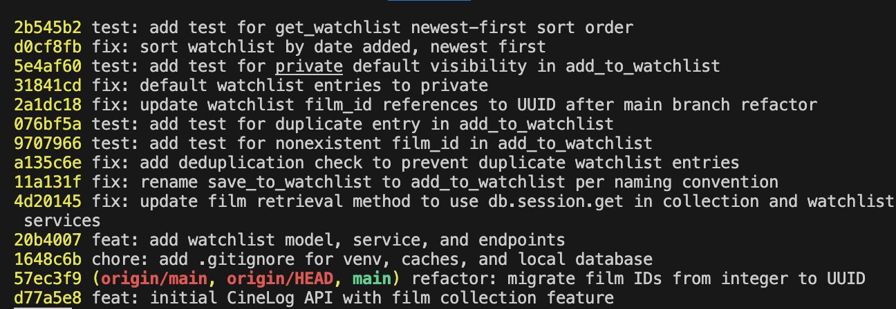

# PR Response Doc: CineLog Watchlist Feature

## AI Usage

Claude Code (Opus 5.5) was used inside VS Code for substantial development work throughout this PR. It was used to read and understand the codebase and retrieve the upstream PR's six review comments through `gh api`. It also assisted with implementing Comments 1–3, performing the rebase and resolving the `models.py` conflict, writing the UUID fix commit, and scripting the interactive rebase to reword the original watchlist model commit and move the `.gitignore` commit first.

Claude Code also drafted the factual entries for Comments 1, 2, 3, and 6. I reviewed those entries against the codebase to verify their accuracy.

For Comments 4 and 5, I developed the design positions around default visibility and watchlist sorting, considering the intended behavior of CineLog as a community film-tracking application. ChatGPT was used to help formulate and refine the written explanations and evaluate potential reviewer counterarguments. In particular, the privacy-versus-discoverability tradeoff and the difference between finding a specific film and viewing recent additions were considered when refining the decisions.

All final decisions and explanations reflect my understanding of the project and the reasoning behind the implementation choices.

## Comment 1: Rename

> `save_to_watchlist()` should follow the project's naming convention... Please rename to `add_to_watchlist()` and update all call sites.

**What I did:**
Renamed `save_to_watchlist()` to `add_to_watchlist()` in `services/watchlist_service.py` and updated its docstring summary ("Save a film..." became "Add a film..."). This brings it in line with the `verb_to_noun` convention documented in `CONTRIBUTING.md` and used by `add_to_collection()`, `remove_from_collection()`, and `get_collection()`.

**How I verified:**
I ran a project-wide search (`grep -rn "save_to_watchlist"` over all `.py` and `.md` files, excluding `.venv`) before the change. It found three hits: the definition in `services/watchlist_service.py`, plus the import and the single call site in `routes/watchlist/watchlist.py`. After the rename, the same search returns zero hits, and `pytest tests/ -v` passes.

Commit: `fix: rename save_to_watchlist to add_to_watchlist per naming convention`

## Comment 2: Deduplication

> What happens if a user calls this with a film that's already on their watchlist?

**What I did:**
I followed the existing pattern in `add_to_collection()` (`services/collection_service.py`). That function:
1. Looks up the film with `db.session.get(Film, film_id)` and raises `FilmNotFoundError` if it's missing.
2. Runs a duplicate check, `CollectionEntry.query.filter_by(user_id=user_id, film_id=film_id).first()`, which looks for an existing entry for the same **(user_id, film_id) pair**.
3. If a duplicate is found, it raises a domain-specific `AlreadyInCollectionError` instead of inserting. Nothing is written, and the route turns that error into a **409 Conflict**.
4. Backs this up at the database level with `UniqueConstraint("user_id", "film_id")` on `CollectionEntry`.

I mirrored each piece for the watchlist:
- Added `AlreadyInWatchlistError` in `services/watchlist_service.py`.
- Added the same `filter_by(user_id=..., film_id=...).first()` check in `add_to_watchlist()`, after the film-existence check, which raises `AlreadyInWatchlistError` if an entry exists.
- Added `UniqueConstraint("user_id", "film_id", name="unique_user_film_watchlist")` to `WatchlistEntry`, so a race between two simultaneous requests can't create a duplicate either.
- Wrapped the call in `POST /watchlist/<user_id>/add` in `try/except`, the same way `routes/collection.py` does: `AlreadyInWatchlistError` returns 409 and `FilmNotFoundError` returns 404. Before this, an unknown film surfaced as an unhandled 500.

**How I verified:**
- I called the endpoint through Flask's test client against an in-memory DB. The first add returned `201`, the same film again returned `409 {"error": "Film '...' is already on this user's watchlist"}`, and an unknown film_id returned `404`.
- I added `test_add_to_watchlist_duplicate_raises` (modeled on `test_add_to_collection_duplicate_raises`). It asserts the error is raised and that exactly one row exists afterward.

Commit: `fix: add deduplication check to prevent duplicate watchlist entries`

## Comment 3: Missing test

> Please add a test for the case where `film_id` doesn't exist in the database.

**What I did:**
I created `tests/test_watchlist.py` with `test_add_to_watchlist_nonexistent_film_raises`, modeled directly on `test_add_to_collection_nonexistent_film_raises` in `tests/test_collection.py`. It uses the same structure:
- Same `app` fixture (isolated app with `sqlite:///:memory:`, `create_all` / `drop_all` around each test) and the same `sample_user` fixture.
- Same fake ID, `"00000000-0000-0000-0000-000000000000"`, which is a valid UUID shape that doesn't exist, so the test matches the post-refactor ID format.
- Same assertion: `with pytest.raises(FilmNotFoundError): add_to_watchlist(...)`.
- One extra assertion: no `WatchlistEntry` rows exist for the user afterward, which confirms that nothing was half-written.

CONTRIBUTING.md asks new service functions to have a duplicate test too, so the duplicate test from Comment 2 went into the same file as a separate commit.

**How I verified:**
`pytest tests/test_watchlist.py -v` and `pytest tests/ -v` both pass.

Commits: `test: add test for nonexistent film_id in add_to_watchlist`, `test: add test for duplicate entry in add_to_watchlist`

## Comment 4: Default Visibility (`public=False`)

**My position:** Switch the default to `public=False`.

**Reasoning:**

I believe watchlists should default to private because they represent a user's intentions and future interests rather than simply a record of films they have already watched. Someone might add films they are considering watching, researching, or saving for a particular reason, and they should have control over whether that information is shared with the community. Although CineLog is designed as a community film-tracking app, that does not mean every aspect of a user's activity should automatically be public. Making visibility opt-in still allows users to share their watchlists while giving them the choice to do so intentionally.

I also think this is the right precedent to establish because watchlists are the first user lists with a visibility setting. Collections currently have no visibility control, so establishing a privacy-conscious default now gives us a consistent direction to consider when visibility is eventually implemented across other user lists. Even though the current API does not enforce the flag, choosing `public=False` now establishes the intended behavior before enforcement is introduced. It also avoids making an existing code default the basis for a future privacy decision.

**Tradeoff acknowledged:**

The downside is that default-private watchlists could reduce discoverability and community engagement. Users who expect their lists to be visible may not realize they need to change the setting, which could make it harder for others to discover films through shared watchlists. This primarily affects users who want to participate in the community and share their interests without having to adjust additional settings. However, I think that is a reasonable tradeoff because users can intentionally make their lists public, whereas automatically exposing someone's interests gives them less control over their information.

This PR does not yet give users a way to set `public=True`, because the add endpoint takes only `film_id`. Adding an explicit opt-in control (a `public` field on `POST /watchlist/<user_id>/add`, or a separate update endpoint) is the planned follow-up. Until then, the private default is the safe state.

**Code change:** `WatchlistEntry.public` now has `default=False` in `models.py`. `test_add_to_watchlist_defaults_to_private` asserts that a new entry is private.

Commits: `fix: default watchlist entries to private`, `test: add test for private default visibility in add_to_watchlist`

## Comment 5: Sort Order

**My position:** Sort by `date_added`, newest first.

**Reasoning:**

I would prioritize showing recently added films because a watchlist is an ongoing collection of things a user intends to watch. When someone opens their watchlist, they are often interested in seeing what they recently saved or deciding what to watch next. Sorting by date added makes those additions immediately accessible without requiring the user to search through the entire list.

This also aligns with the existing behavior of `get_collection()`, which already sorts entries by `date_added` with the newest first. Keeping the same behavior across user lists creates a more consistent experience throughout CineLog. Since `date_added` is already stored for every watchlist entry, implementing this order does not introduce additional data requirements or meaningful performance costs compared with alphabetical sorting.

**Engagement with the reviewer's point:**

I agree with the reviewer's point that most users are likely interested in seeing what they added recently. I think this becomes even more important as a watchlist grows. With five films, alphabetical sorting and date-added sorting may not make much of a difference. However, with 100 or 200 films, recently added entries could become difficult to locate if the list is always alphabetical. Alphabetical sorting is useful when someone is specifically looking for a particular film, but I think that is a secondary use case compared with keeping track of recent additions. For that reason, I would make newest-first the default rather than introduce a `?sort=` parameter right now. Additional sorting options could be considered later if users need more control.

**Tradeoff acknowledged:**

The downside is that users looking for a specific film may find alphabetical sorting more convenient, especially when managing larger watchlists. Newest-first sorting also means older entries will move farther down the list over time. However, I believe prioritizing recent activity is more useful for the primary purpose of a watchlist, and additional sorting functionality can be introduced later if needed.

**Code change:** `get_watchlist()` now orders by `WatchlistEntry.date_added.desc()` instead of `Film.title.asc()`. The `join(Film)` that only existed for title sorting has been removed. `test_get_watchlist_returns_newest_first` is modeled on `test_get_collection_returns_newest_first`. It adds "Alien" five days before "Blade Runner", so the test would fail if the list were still alphabetical.

Commits: `fix: sort watchlist by date added, newest first`, `test: add test for get_watchlist newest-first sort order`

## Comment 6: Rebase

> A refactor merged to `main` that changed film IDs from integers to UUIDs... Please rebase on `main` and update accordingly.

**What conflicted:**
`git rebase origin/main` stopped on the original watchlist commit with a conflict in `models.py` on one line, `WatchlistEntry.film_id`:
- `main` (commit `57ec3f9 refactor: migrate film IDs from integer to UUID`) had changed it to `db.Column(db.String(36), db.ForeignKey("film.id"), nullable=False)`.
- My branch had `db.Column(db.Integer, db.ForeignKey("film.id"), nullable=False, index=True)`. That was the old integer type plus an index I had added.

**How I resolved it:**
I took main's type and kept my branch's index:
`film_id = db.Column(db.String(36), db.ForeignKey("film.id"), nullable=False, index=True)`.
Main's type is the source of truth, because `Film.id` is now a `String(36)` UUID and the foreign key has to match it. The index was an intentional part of my change and doesn't conflict with the refactor. After `git rebase --continue` finished, I searched the watchlist code for leftover integer-ID assumptions and found two. The `add_to_watchlist()` docstring said `film_id (int): ... (Note: integer — pre-refactor)`, and the route docstring said `Body: { "film_id": <int> }`. I updated both to UUID strings in a separate commit, so the UUID work is visible in the history instead of hidden inside the conflict resolution.

Commit: `fix: update watchlist film_id references to UUID after main branch refactor`

**How I verified no conflict remains:**
- `grep -n "<<<<<<<\|=======\|>>>>>>>" models.py` returns nothing.
- `grep -rniE "int>|\(int\)|pre-refactor"` over the source returns no film-ID hits.
- `git log --merges --oneline origin/main..HEAD` returns 0 lines, so there are no merge commits, and `57ec3f9` sits directly under my branch's commits.
- `pytest tests/ -v` passes. The tests use UUID film IDs end to end: the test films get UUIDs from `generate_uuid`, and the fake ID is UUID-shaped.

## Commit history

After cleanup with `git rebase -i origin/main`, the original commit `added watchlist model and endpoint fixed a bug more changes` was reworded to conventional format, and the `.gitignore` commit was moved to the front.



The topmost `docs:` commits (adding this file and this screenshot) are cropped out of the image. The full list is in the text block above.

```
docs: add git log screenshot and visibility follow-up note to pr-response.md
docs: add pr-response.md with review responses and design decisions
test: add test for get_watchlist newest-first sort order
fix: sort watchlist by date added, newest first
test: add test for private default visibility in add_to_watchlist
fix: default watchlist entries to private
fix: update watchlist film_id references to UUID after main branch refactor
test: add test for duplicate entry in add_to_watchlist
test: add test for nonexistent film_id in add_to_watchlist
fix: add deduplication check to prevent duplicate watchlist entries
fix: rename save_to_watchlist to add_to_watchlist per naming convention
fix: update film retrieval method to use db.session.get in collection and watchlist services
feat: add watchlist model, service, and endpoints
chore: add .gitignore for venv, caches, and local database
refactor: migrate film IDs from integer to UUID          <- main
feat: initial CineLog API with film collection feature   <- main
```

## PR Description

### What this does
Adds a watchlist so CineLog users can save films they want to watch later, separate from their collection of films they've already watched. It adds a `WatchlistEntry` model, an `add_to_watchlist()` / `get_watchlist()` service layer that follows the collection service's patterns (including duplicate prevention), and two REST endpoints.

### Design decisions
- **Default visibility:** Watchlists default to `public=False` because users should intentionally choose when to share their future viewing interests with the CineLog community.
- **Sort order:** Watchlists are sorted by `date_added` newest first because users should be able to see their most recent additions immediately, consistent with collection sorting.
- **Duplicates:** Adding a film that's already on the watchlist returns 409 Conflict, matching the collection endpoint. A DB unique constraint on (user_id, film_id) enforces the same rule.

### How to test manually
```bash
python -m venv .venv && source .venv/bin/activate
pip install -r requirements.txt
rm -f instance/cinelog.db cinelog.db      # start from a fresh schema
python seed.py                            # prints the demo user_id
python app.py                             # serves on http://127.0.0.1:5000
```
In a second terminal:
```bash
USER=<user_id printed by seed.py>
curl -s http://127.0.0.1:5000/films/      # copy a film "id" (a UUID)
FILM=<film uuid>

# 1. Add a film: expect 201 and the new entry with "public": false
curl -s -X POST http://127.0.0.1:5000/watchlist/$USER/add \
  -H "Content-Type: application/json" -d "{\"film_id\": \"$FILM\"}"

# 2. Add the same film again: expect 409 "already on this user's watchlist"
curl -s -w "\n%{http_code}\n" -X POST http://127.0.0.1:5000/watchlist/$USER/add \
  -H "Content-Type: application/json" -d "{\"film_id\": \"$FILM\"}"

# 3. Add a nonexistent film: expect 404
curl -s -w "\n%{http_code}\n" -X POST http://127.0.0.1:5000/watchlist/$USER/add \
  -H "Content-Type: application/json" -d '{"film_id": "00000000-0000-0000-0000-000000000000"}'

# 4. Add a second film, then view the watchlist: the newest addition is listed first
curl -s http://127.0.0.1:5000/watchlist/$USER
```
Automated tests: `pytest tests/ -v` (8 passing).

🤖 Generated with [Claude Code](https://claude.com/claude-code)
